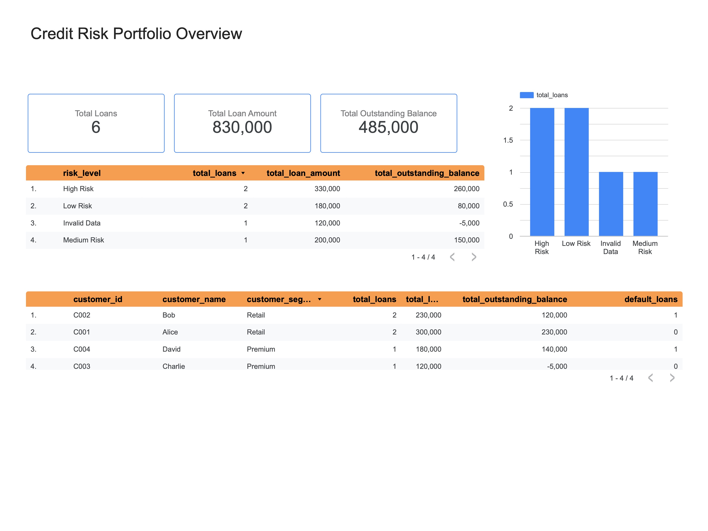

# Credit Risk Data Quality & Portfolio Analysis

## Overview

This project uses SQL and PostgreSQL to examine loan data, identify data quality issues, and analyze loan portfolio information.

The project demonstrates practical SQL skills relevant to entry-level Data Analyst and Credit Risk Analyst roles, including data quality checks, loan portfolio analysis, customer analysis, risk segmentation, and default analysis.

## Tools

- PostgreSQL
- SQL
- Docker
- Google Sheets
- Google Looker Studio

## Dataset

The project uses six synthetic loan records created for SQL practice. The dataset includes loan amounts, outstanding balances, days past due, and default indicators.

Customer information is also included to demonstrate SQL joins and customer-level analysis.

This is synthetic practice data and does not represent real customers or bank records.

## Project Objectives

- Identify missing values and invalid records.
- Detect negative outstanding balances and negative days past due.
- Summarize loan portfolio information.
- Combine customer and loan data using SQL joins.
- Classify loans into different risk segments.
- Analyze default rates and portfolio risk.
- Present key findings through an interactive dashboard.

## SQL Skills Demonstrated

- **Data Retrieval & Filtering:** SELECT, WHERE, ORDER BY
- **Aggregate Functions:** COUNT, SUM
- **Data Aggregation:** GROUP BY, HAVING
- **Conditional Logic:** CASE WHEN for risk classification
- **Data Joining:** LEFT JOIN to combine customer and loan data
- **Data Quality Checks:** Identifying missing values (NULL), negative values, and invalid records
- **Credit Risk Analysis:** Loan portfolio summaries, risk segmentation, and default analysis

## Project Structure

```text
credit-risk-sql/
├── dashboard/
│   ├── customer_analysis.csv
│   ├── portfolio_risk.csv
│   └── risk_segmentation.csv
├── images/
│   └── credit-risk-dashboard.png
├── results/
│   ├── 01_data_quality_checks.txt
│   ├── 02_loan_portfolio_summary.txt
│   ├── 03_risk_classification.txt
│   ├── 05_customer_loan_join.txt
│   ├── 07_default_rate_analysis.txt
│   ├── 08_risk_segmentation.txt
│   ├── 09_portfolio_risk_analysis.txt
│   └── 10_default_analysis.txt
├── sql/
│   ├── 01_data_quality_checks.sql
│   ├── 02_loan_portfolio_summary.sql
│   ├── 03_risk_classification.sql
│   ├── 04_create_customers.sql
│   ├── 05_customer_loan_join.sql
│   ├── 06_customer_loan_analysis.sql
│   ├── 07_default_rate_analysis.sql
│   ├── 08_risk_segmentation.sql
│   ├── 09_portfolio_risk_analysis.sql
│   └── 10_default_analysis.sql
├── compose.yaml
└── README.md
```

### Folder Descriptions

- `sql/` — SQL scripts for data quality checks, loan analysis, customer joins, risk segmentation, and default analysis.
- `results/` — Query outputs generated from PostgreSQL.
- `dashboard/` — CSV files exported for dashboard development.
- `images/` — Dashboard preview image.
- `compose.yaml` — Docker Compose configuration for PostgreSQL.

## Dashboard

The project includes an interactive dashboard developed using Google Looker Studio, with Google Sheets as the data source.

The dashboard presents key portfolio metrics and visualizations, including:

- **KPI Summary:** Total loans, total loan amount, and total outstanding balance.
- **Risk Segmentation:** Loan distribution across different risk levels.
- **Portfolio Analysis:** Loan amounts and outstanding balances by risk category.
- **Customer Analysis:** Loan portfolio details and default counts by customer.

### Dashboard Tools

- Google Sheets
- Google Looker Studio

### Dashboard Preview



## Current Findings

- The dataset contains six loan records.
- One loan record has a missing outstanding balance.
- One loan record contains a negative outstanding balance and negative days past due.
- The total outstanding balance is 485,000, including the invalid negative balance of -5,000.Excluding this invalid record, the total is 490,000.

## Business Insights

### 1. High-Risk Portfolio

The High Risk segment contains 2 loans, with a total loan amount of 330,000 and an outstanding balance of 260,000. These loans require closer monitoring and follow-up due to their existing default status.

### 2. Medium-Risk Exposure

The Medium Risk segment contains 1 loan, with an outstanding balance of 150,000 and 45 days past due. Early collection actions and regular payment monitoring may help prevent further deterioration.

### 3. Data Quality Issues

One loan record contains invalid values, including a negative outstanding balance of -5,000 and negative days past due. Data validation and investigation should be performed before using this record for portfolio reporting or credit risk analysis.

## Limitations

- The dataset is small and synthetic.
- The risk classification rules are simplified for demonstration purposes.
- The findings should not be interpreted as real-world credit risk conclusions.
- Invalid records may affect portfolio metrics and should be investigated before making business decisions.

## Future Improvements

- Expand the dataset to include more loan records.
- Add more comprehensive data validation rules.
- Explore advanced SQL techniques such as Common Table Expressions (CTEs) and window functions.
- Develop additional credit risk indicators and portfolio monitoring metrics.
- Improve dashboard interactivity and analytical insights.